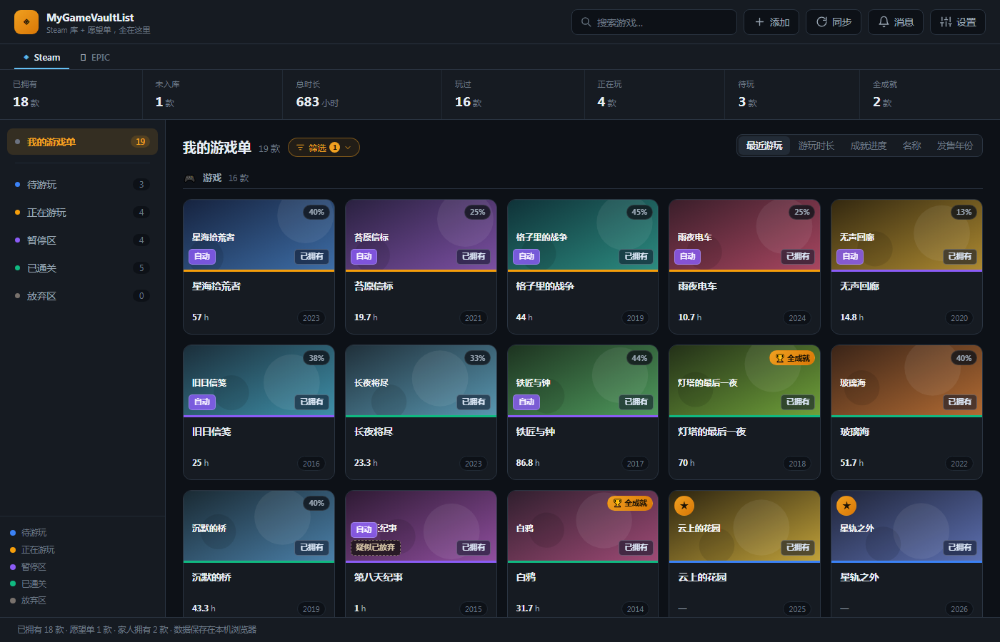
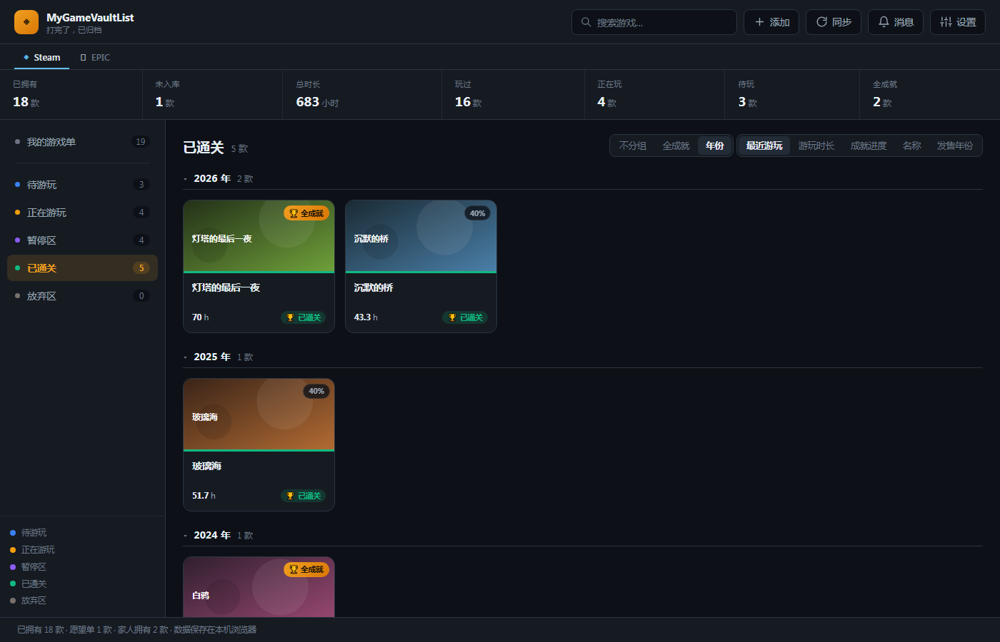
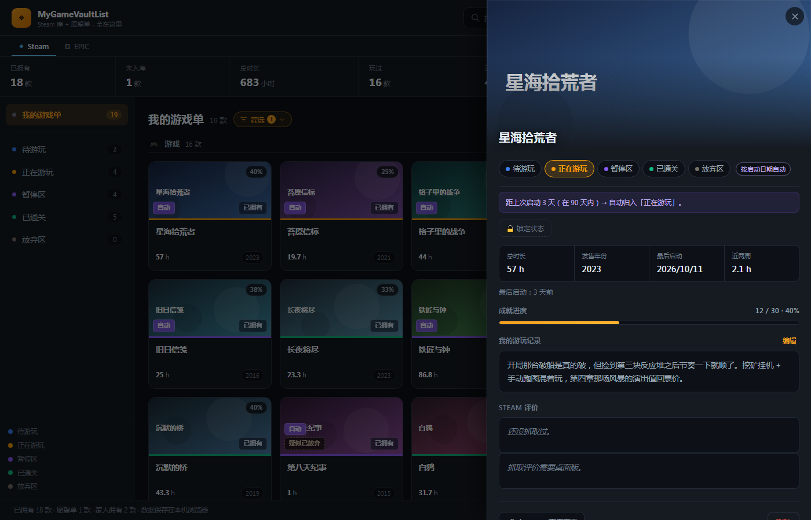

# MyGameVaultList · 我的游戏清单

> 本地记录你**玩过的游戏、当前进度、和接下来想玩的计划**。
> Steam / EPIC 库自动同步，进度与感想自己写。
> **数据全在你自己的机器上** —— 不联网、不上传、不需要账号。

<p align="center">
  
</p>

---

## 它能做什么

- **六个区块，一屏看清自己的游戏生涯** —— 我的游戏单（全集）/ 待游玩 / 正在游玩 / 暂停区 /
  已通关 / 放弃区。同一款只在一个状态区里，但永远属于全集。
- **自动归类，也永远听你的** —— 按「最后启动时间」的 90 天规则自动分流；收藏夹能一键归类；
  你手动改过的状态同步时不覆盖，想让某款**永久钉死**就点「锁定」。
- **写你自己的记录** —— 每款都能写游玩感想，桌面版还能把你**自己写过的 Steam 评测**抓回本地存好。

想细看：[使用说明](docs/usage.md) · [自动归类规则](docs/classification.md) ·
[桌面版](docs/desktop.md) · [常见问题与已知限制](docs/faq.md)

<table>
  <tr>
    <td width="50%">
      <br>
      <sub>「已通关」按年份自动分段，拖卡片就能改年份</sub>
    </td>
    <td width="50%">
      <br>
      <sub>点开卡片：状态 / 时长 / 成就进度 / 自己写的游玩记录</sub>
    </td>
  </tr>
</table>

---

## 快速开始

### 1. 拿到代码

```bash
git clone https://github.com/sorunaway/MyGameVaultList.git
cd gamevault
```

> 📌 应用叫 **MyGameVaultList**，仓库目录与本地存储身份仍是 **`gamevault`** ——
> 改名只改了给人看的那层，动存储身份 = 把已有数据丢掉。
> 详见 [命名与存储身份](docs/development.md#命名与存储身份改名前必读)。

### 2. 打开应用

直接双击 `index.html` 就能用（不需要服务器、不需要构建）。

> 如果浏览器提示跨域问题，用本地服务器打开：
> ```bash
> python -m http.server 8777
> ```
> 然后访问 http://127.0.0.1:8777

⚠️ **第一次打开是空库，这是正常的** —— 仓库里不含任何游戏数据。下一步把你自己导进去。

### 3. 导入你自己的 Steam 数据

```bash
cp .env.example .env      # 填入自己的 STEAM_API_KEY 与 STEAM_ID
python scripts/sync.py    # 生成 data/steam_sync.json
```

然后回到应用，点**「同步」**按钮，选那个文件即可。

> 🖥️ **桌面版（`.exe` / `python desktop/main.py`）不用做这一步** ——
> 它自己就能读本机 Steam 文件，点「同步」当场读完，见
> [桌面版：同步按钮点一下就同步](docs/desktop.md#桌面版同步按钮点一下就同步)。
> 上面这套「跑脚本 + 选文件」是给**浏览器版**（读不到你的硬盘）用的，
> 也可以当**数据备份**的导入端（导出入口在「设置 → 数据备份」里）。

> 没有 Key 也能先跑起来：本机装了 Steam 客户端的话，脚本会自动读本地文件，
> 拿到**库里已安装/玩过的那部分**（含全部游玩时长）与本地封面，
> 这一步**不联网、不需要 Key**。Key 是用来补「完整库 + 成就 + 愿望单」的。

拿到 Key：<https://steamcommunity.com/dev/apikey>
（前提：账号**非受限** —— 累计消费 $5 以上，且绑了手机令牌。）
`sync.py` 的完整参数与缓存说明见 [使用说明](docs/usage.md) 与 `.env.example`。

---

## 下载（不想自己跑代码的话）

到 **[Releases](https://github.com/sorunaway/MyGameVaultList/releases)** 拿打包好的
Windows 试用包（`.zip`）—— 解压后**双击 `mygamevaultlist-desktop.exe`** 就能用，不用装 Python。

⚠️ 三条收包人最容易卡的（说明书里也写了）：

- 首次运行 SmartScreen 会拦 → 点「更多信息」→「仍要运行」。
- **不能只把 exe 拖出来** —— 整个文件夹一起用（`_internal/` 不能丢，否则报
  `Failed to load Python DLL`）。
- **首屏是空的要点一下「同步」** —— 数据来自你自己本机的 Steam。

---

## 文档

| 文档 | 讲什么 |
|---|---|
| [使用说明](docs/usage.md) | 平台标签页（Steam / EPIC）、六个区块、卡片与详情、过滤、排序、消息记录、常用操作 |
| [自动归类规则](docs/classification.md) | 完整优先级链、90 天规则、锁定 / 放弃区 / 批量选择 |
| [桌面版](docs/desktop.md) | 本机服务、为什么固定 47615 端口、同步机制、成就分批、名字与封面补全 |
| [常见问题与已知限制](docs/faq.md) | 收藏夹名不一样怎么办、Steam 装在别处怎么办、这个工具做不到哪些事 |
| [开发与维护](docs/development.md) | 命名与存储身份、目录结构、怎么验、怎么出包发人 |

---

## 许可与致谢

本项目以 **MIT 许可** 发布，见 [LICENSE](LICENSE)。

- 游戏数据来自 **Steam Web API** 与本机 Steam 客户端文件（只读）；
  EPIC 数据来自本机 `%PROGRAMDATA%\Epic\` 下的缓存文件（只读）。
- 本项目与 Valve / Epic Games **没有隶属关系**，游戏名称与封面版权归各自发行商所有。
- 界面的「已完结」等收藏夹名是本项目自己起的默认名，**只有「已隐藏」是 Steam 自带**的。
